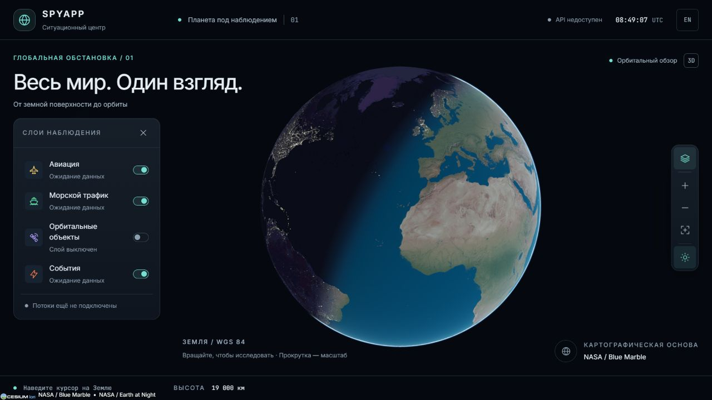
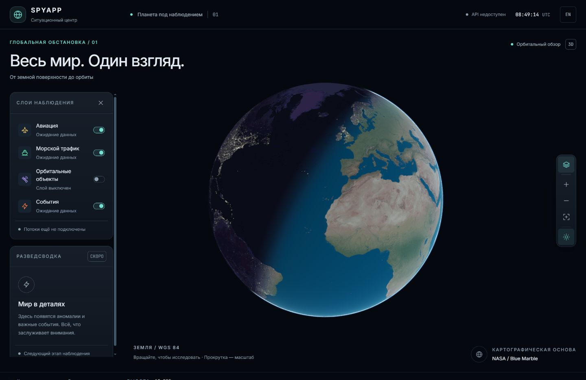
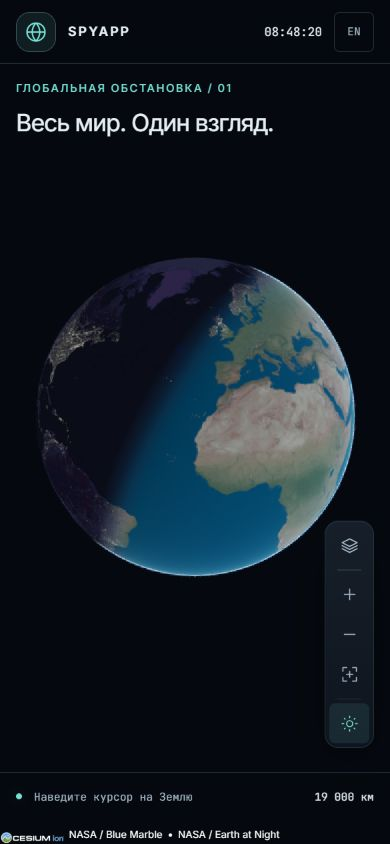

# F1 · Первый макет «Ситуационного центра»

**Статус:** макет принят Alex для демо. Ветка `codex/f1-interface`. Задача спринта остаётся в работе до мержа.

## Что смотреть

Объёмная Земля с атмосферой, солнечным светом и ночными огнями; мягкие графитовые панели; компактная панель наблюдения. Доступность API проверяется отдельно от live-потоков. Счётчики не выдуманы: слои прямо сообщают, что данные ещё не подключены. Разведсводка — заглушка следующей фазы.

Без токена ion используются локальные изображения NASA. С токеном — снимки и рельеф Cesium ion. Переключатель освещения отключает солнечное затенение вместе с ночным слоем.

## Превью

Desktop 1280×720:

Высокий экран 1440×960: видна заглушка сводки; колонка допускает прокрутку.

Мобильный экран 390×844: панель слоёв изначально закрыта.

## Как проверить

1. `pnpm --filter @spyapp/web dev`, открыть `http://localhost:5173`.
2. Без API и без ion проверить появление Земли, атрибуцию и статус «API недоступен».
3. Вращать глобус и приблизить кнопками; координаты относятся к поверхности под курсором, высота следует за камерой. Увести курсор с глобуса — координаты очищаются.
4. Вернуть исходный вид; переключить освещение; открыть и закрыть слои кнопкой, `L` и `Esc`.
5. Изменить переключатель слоя: статус меняется между ожиданием данных и выключенным состоянием.
6. Переключить RU/EN, перезагрузить — язык сохраняется.
7. На узком экране проверить скрытую при запуске панель, её открытие, управление камерой и отсутствие горизонтального скролла.

Пройдены ручные проверки в браузере: desktop, высокий экран, mobile, масштаб 19 000 → 12 350 км и возврат, слои, освещение, RU/EN, `L`/`Esc`. Консоль при рабочей сцене без ошибок Cesium. Проверка с ion-токеном не проводилась.

Автоматические проверки: `turbo run lint typecheck test` и web production build проходят. Общий `pnpm check` обнаруживает ошибки форматирования во вложенном `.claude/worktrees/b1`, в том числе в сгенерированных ассетах Cesium. Чужие файлы не менялись; запрос на исключение worktree из Prettier оставлен Claude в спринте. Форматирование изменённых файлов F1 проверяется отдельно.

## Границы задачи

- Потоки, объекты и реальные счётчики — F2/F6.
- Досье, команды и орбиты — F3/F4/F5.
- URL состояния — F6.
- Ночные огни — статическая текстура; время UTC и солнечное освещение не делают её актуальным снимком.
- Высокое разрешение на уровне городов требует ion. Локальный фон предназначен для орбитального макета.

Источники изображений и атрибуция: [README ассетов](../../apps/web/public/earth/README.md). Правила материалов и токены: [дизайн-система](../07-design.md).
