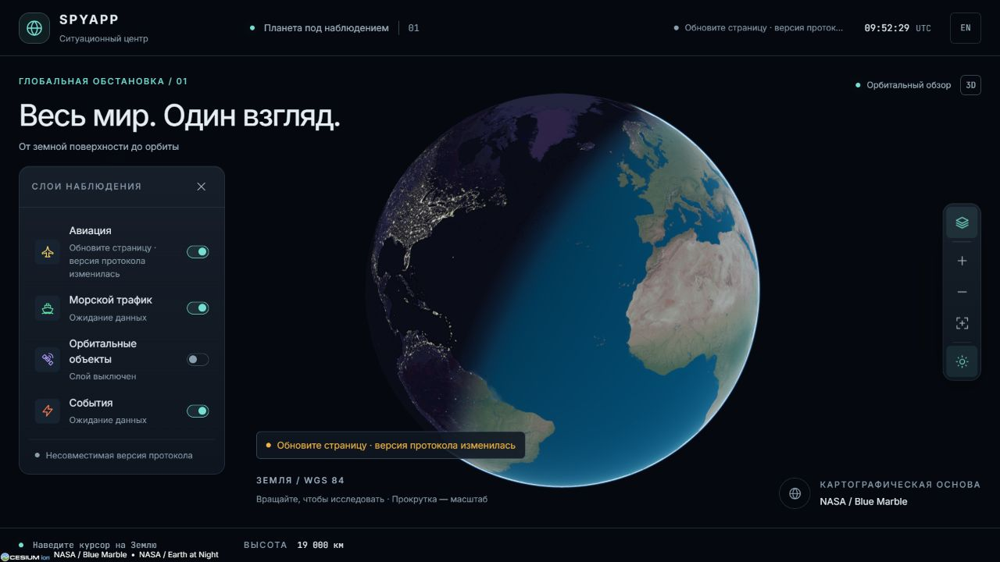
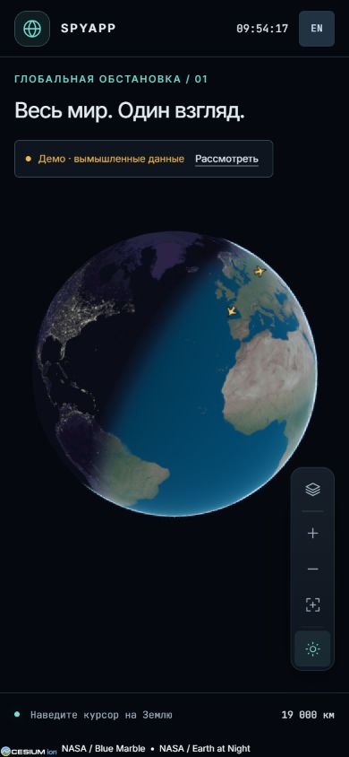

# F2 · Поток и самолёты на глобусе

**Статус:** реализовано. PR #3 из `codex/f2-live-aircraft` влит в `codex/f1-interface`; объединённые F1/F2 ожидают мержа в `main` через PR #2. Задача остаётся 🟨 до попадания в `main`.

## Поведение

- Пока сервер не прислал первый валидный `snap`, на глобусе движутся три вымышленных самолёта из `@spyapp/shared/fixtures`. HUD прямо обозначает деморежим.
- После `hello` совместимой версии клиент отправляет `sub` с текущими bbox, zoom и включённой авиацией. При остановке камеры отправляется `view`; при смене слоёв — новый `sub`.
- Валидный серверный snapshot заменяет локальные фикстуры целиком. Дельты добавляют, обновляют и удаляют объекты. Источники `fixture` и `simulator` также явно помечаются как симуляция, даже если данные пришли по WS.
- При потере связи сохраняются последние серверные объекты со статусом устаревших данных. Локальные фикстуры к ним не примешиваются. Переподключение использует экспоненциальную задержку с jitter, максимум 30 секунд.
- После reconnect дельты не применяются до свежего snapshot. Исходная подписка восстанавливается с актуальной камерой и состоянием слоя.
- Вход проверяется через `ServerMessageSchema`. Повреждённый JSON, неправильная схема и объекты другого слоя отклоняются. Несовпадение `PROTOCOL_VERSION` очищает авиацию, останавливает подключение и просит обновить страницу.
- Отсутствие `hello` дольше 8 секунд и молчание начавшегося потока дольше 15 секунд запускают переподключение. Сервер, приславший только `hello`, оставляет клиент в демонстрационном режиме ожидания B1.
- Выключение авиации убирает примитивы и её подписку; включение восстанавливает подходящий источник. В деморежиме кнопка «Рассмотреть» приближает камеру к первому самолёту.

## Рендер и движение

`LiveClient → AircraftLayer → LayerRenderer → BillboardCollection`. Координаты и объекты хранятся в императивной карте движка. React/Zustand получают только редкие изменения состояния потока.

Иконка самолёта создаётся один раз из цветов и размера `packages/ui`, поворачивается по курсу и скрывается за Землёй глубиной сцены. Движение обновляется максимум 30 раз в секунду. После остановки всех объектов перерисовка движения прекращается.

Между измерениями сглаживается поправка координат и курса. Прогноз по скорости ограничен тремя секундами; без курса направление не выдумывается. Обработаны короткий путь через антимеридиан, поворот 350° → 10° и движение через полюс. Устаревшие и повторные измерения не откатывают объект назад.

Все таймеры, обработчики камеры, WS и коллекция освобождаются при уничтожении слоя. Контракт `packages/shared` не менялся.

## Проверки

`pnpm --filter @spyapp/web test`: 17 тестов.

- Жизненный цикл WS: handshake, валидация, несовместимая версия, backoff, свежий snapshot после reconnect, смена viewport/слоёв, watchdog и stop.
- Геометрия подписки: антимеридиан, весь мир, границы zoom.
- Движение: полюс, антимеридиан, интерполяция высоты/курса, старые измерения, ограничение прогноза.
- Настоящая коллекция Cesium без WebGL: snapshot/delta/remove, повторное использование billboard, очистка, создание и обновление 10 000 примитивов. Этот тест не измеряет GPU/FPS.

`pnpm check` и `pnpm build` проходят после объединения с актуальным `main`, содержащим B1/B2. Прежняя помеха форматированию вложенного `.claude/worktrees/b1` устранена владельцем сборки в PR #1.

Ручная проверка в браузере: самолёты на глобусе, приближение, выключение и восстановление авиации, RU/EN, 390×844 без горизонтального переполнения. Через временный локальный WS-сервер проверены приём snapshot/delta, переход с фикстур на поток, повреждённый JSON, потеря связи и несовместимая версия. Тестовый сервер остановлен.

**Ограничения:** ручная сквозная интеграция с реализацией B1 и реальными данными B2 пока не проверена; B1/B2 уже доступны в актуальном `main`. Фильтры/счётчики и URL остаются F6, досье — F3.

## Превью

