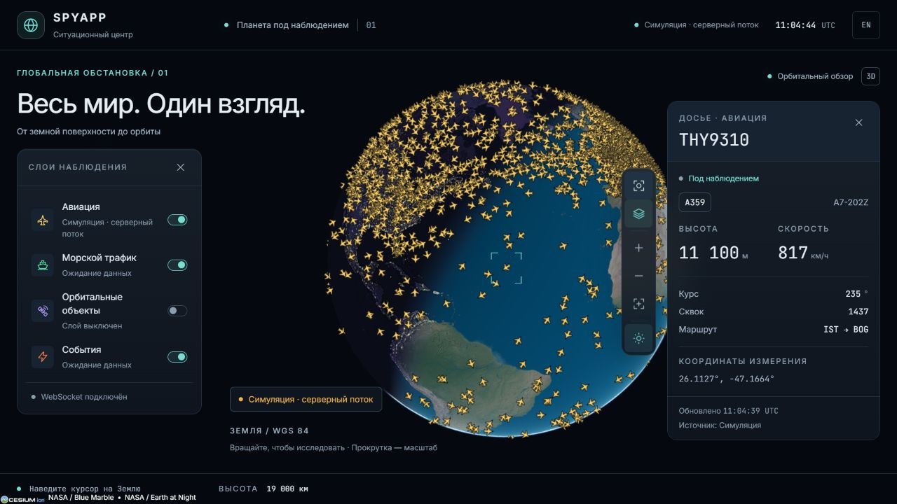
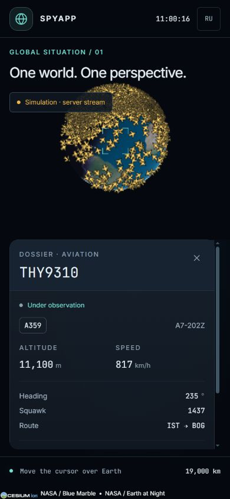

# F3 · Карточка самолёта и прицел

**Статус:** влито в main через PR #6. Исправление F2+B1 из PR #5 также в main. B4 уже добавил REST-контракт; подключение фотографий и расширенных сведений к досье остаётся отдельным продолжением.

## Поведение

Нажатие на самолёт открывает досье с позывным, типом, регистрацией, высотой, скоростью, курсом, сквоком, маршрутом и временем последнего измерения. Неизвестные поля обозначены тире; несуществующие сведения не выдумываются.

Прицел следует за отрисованной позицией самолёта, скрывается за Землёй и за границами экрана. Он обновляется через postRender и DOM, без покадрового React-стейта. Карточка получает только выбранный TrackedObject и обновляется при новых измерениях. Типы и проверка props берутся из @spyapp/shared.

Пустой клик, Esc, крестик, удаление объекта, выключение авиации и несовместимый протокол снимают выбор. При обрыве WS досье сохраняет последний объект с явным статусом устаревших данных, а движение останавливается.

Кнопка с прицелом выбирает ближайший к центру видимый самолёт и даёт вход с клавиатуры. Если бортов нет, показывается сообщение. После выбора фокус переносится в досье. На узком экране карточка становится нижней панелью, а глобус уменьшается сверху: цель остаётся видимой. Заголовок с закрытием закреплён при прокрутке.

Источники simulator/fixture явно обозначаются как симуляция. Для adsb.lol в досье предусмотрена атрибуция ODbL. Карточка показывает координаты именно последнего измерения; прицел использует интерполированную позицию.

## Проверки

`pnpm check` и `pnpm build` проходят локально. При повторных retry проверено неизменное положение замороженного прицела и восстановление измерений после подключения.

- 25 автоматических тестов web проходят; интеграционный тест B1 запускается отдельно через SPYAPP_B1_WS_URL.
- Четыре теста выбора: клик, обновление выбранного объекта, удаление, чужой primitive, очистка обработчиков, скрытие прицела за Землёй/экраном и выбор доступной цели.
- В браузере с настоящим B1 проверены клик по billboard, выбор кнопкой, новые измерения в досье, Esc, выключение авиации, обрыв WS, RU/EN и mobile 390×844 с прокруткой.
- Фото, REST-досье и глобальный поиск не подключались; URL выбора остаётся F6.

## Превью

