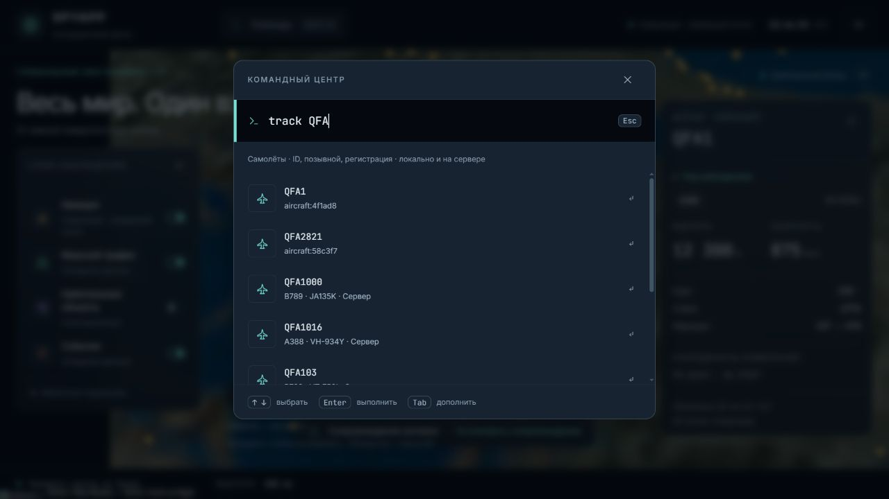
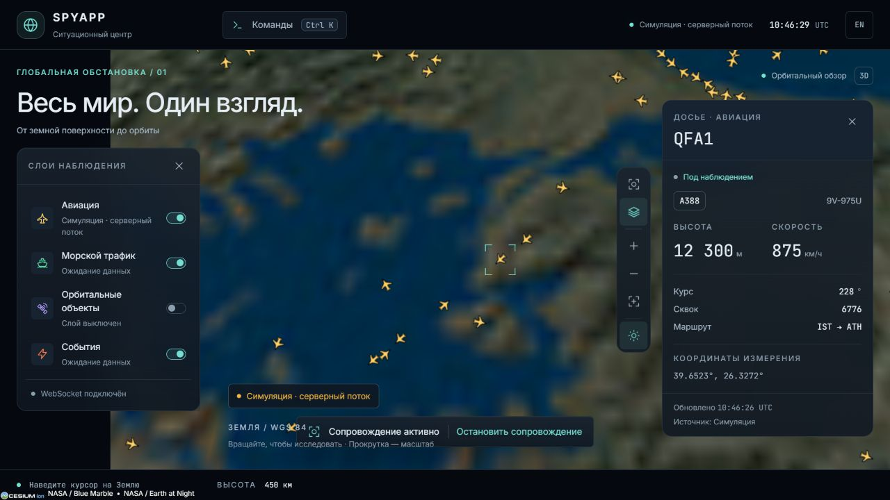
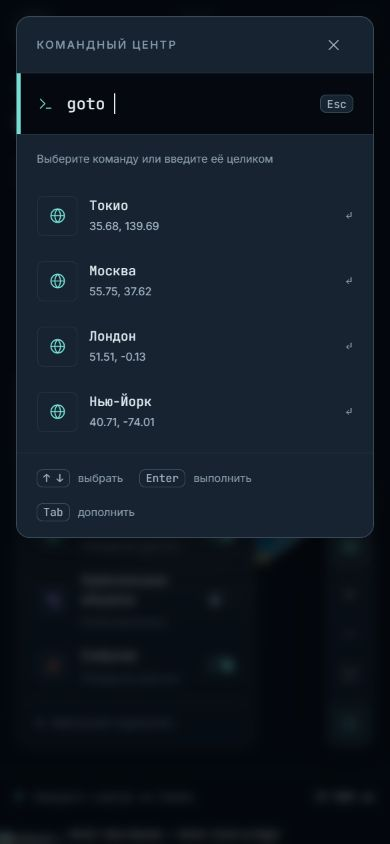

# F4 · Командная строка

Задача спринта 01. Ветка `codex/f4-command-bar`, PR в `main` после мержа F3 (#6) и B4 (#7). Используются готовые REST-схемы из `@spyapp/shared`; контракт и зависимости фронтенда не менялись.

Открытие: кнопка в шапке, `Ctrl+K` или `Cmd+K`. Нативный диалог удерживает фокус, делает фон неактивным и возвращает фокус после закрытия. Ввод получает фокус сразу. Стрелки выбирают подсказку, Enter выполняет, Tab дополняет выбранную подсказку, Escape закрывает диалог и сохраняет открытое досье.

| Команда                                 | Поведение                                                                   |
| --------------------------------------- | --------------------------------------------------------------------------- |
| `track <ID / позывной / регистрация>`   | Поиск самолёта, открытие досье и сопровождение камерой                      |
| `track off`                             | Остановка сопровождения, досье остаётся открытым                            |
| `goto <широта> <долгота> [высота в км]` | Перелёт к координатам; высота по умолчанию 750 км                           |
| `goto tokyo`                            | Быстрые направления: Tokyo, Moscow, London, New York; есть русские названия |
| `goto SVO`                              | Поиск аэропорта по коду или названию через B4                               |
| `layer <id> [on / off / toggle]`        | Управление слоем; без режима переключает текущее состояние                  |

Координаты разделяются пробелами; десятичный разделитель — точка или запятая. Допустимы широта −90…90, долгота −180…180, высота 0,3…45 000 км. Неизвестные команды и неверные значения показывают ошибку без изменения вида. Неоднозначный поиск предлагает выбрать конкретный борт. Точное совпадение ID имеет приоритет, затем точный позывной/регистрация, затем частичные совпадения.

История сохраняет до 12 успешных команд в localStorage, четыре последних видны при открытии. Повтор поднимается наверх. Повреждённая или недоступная история не мешает командам работать.

Сопровождение обновляет систему координат камеры по отрисованному положению примитива Cesium. В React остаются только выбранный объект и ID сопровождения; кадры и полный список объектов туда не попадают. Подписка по viewport обновляется во время сопровождения не реже раза в пять секунд. Закрытие досье, выбор другого борта, выключение авиации, удаление борта, `goto` и сброс камеры прекращают сопровождение.

Подсказки объединяют локальные самолёты с `/api/search`. Запросы начинаются от двух символов, задержка перед отправкой 250 мс. Предыдущий запрос отменяется при изменении строки; ответы проверяются по `SearchResponseSchema`. Борт вне viewport сначала загружается через `/api/objects/:id`, проверяется по `ObjectDetailsResponseSchema`, затем передаётся рендереру и WS-подписке. Закрытие строки отменяет исполнение до перемещения камеры. Тайм-аут REST — 6 секунд; локальные команды продолжают работать при недоступном API.

Ограничения: сервер ищет только объекты своего текущего мира и 57 аэропортов из B4; поиск произвольных адресов относится к B6. Названия четырёх городов — локальные быстрые направления. Сопровождение борта вне вида требует подключённого WS. Команды остальных слоёв переключают их состояние; потоки добавляются отдельными задачами. Синхронизация вида с URL относится к F6. Фото и расширение досье после B4 — отдельная задача.

Проверки:

- Тесты разбора команд, границ координат, неоднозначного поиска, приоритета ID, лимита подсказок и восстановления истории.
- Тесты REST-контракта B4: проверка схем, ошибок HTTP, несовпадения ID, отмены fetch и неоднозначных мест.
- Браузер с `SIMULATE=1`: выключение/включение авиации, отказ `track` при выключенном слое, переход в Токио, выбор борта стрелками и Enter, сопровождение более минуты, `track off`.
- Ctrl+K, фокус ввода и возврат фокуса, Escape с открытым досье, Tab для дополнения, история после перезагрузки, ru/en.
- B4 в браузере: `goto SVO`, серверные подсказки и сопровождение самолёта вне прежнего viewport.
- Адаптивный вид 390×844 без горизонтального переполнения; проверен в браузере, без физической мобильной клавиатуры.
- `pnpm check` и `pnpm build`; отдельно включён интеграционный тест F2+B1 против локального WebSocket.

